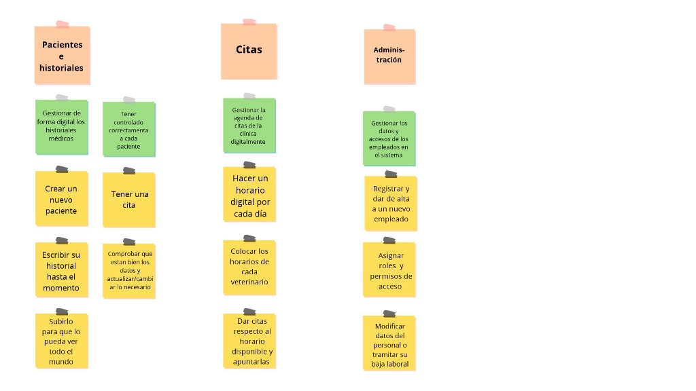

# Clínica Veterinaria

## Miembros del grupo L6-DF-3

1. Torres Muñoz, Jose Antonio
2. Martínez Cintas, Pilar
3. Palma Pastrana, Virginia
4. Izquierdo Burguillos, Alejandro

---

## Índice

1. Introducción al problema
2. Glosario de términos
3. Visión general del sistema
   
   3.1. Requisitos generales (Objetivos)
   
   3.2. Usuarios del sistema (Roles)
4. Catálogo de requisitos
   
   4.1. Mapa de historias de usuario
   
   4.2. Requisitos de información
   
   4.3. Reglas de negocio
   
   4.4. Requisitos funcionales (sólo listados y consultas)
   
   4.5. Requisitos no funcionales
  
   4.6. Pruebas de aceptación de reglas de negocio

---

## 1. Introducción al problema

Nuestra propuesta se centra en la "Clínica Veterinaria Joviralpi". Durante el último año, la clínica ha experimentado un crecimiento, aumentando sus clientes en un 150% y ampliando su plantilla de dos a cinco veterinarios, además de incorporar personal de recepción.

Actualmente, el sistema de información de la clínica opera de manera tradicional, dependiendo casi en su totalidad del papel. La gestión se realiza mediante un sistema de archivos físicos y fichas impresas para cada paciente. Las citas se anotan en una agenda de sobremesa.

Este crecimiento repentino ha desbordado la capacidad operativa del sistema actual, generando una serie de problemas que afectan tanto a la eficiencia interna como a la calidad del servicio ofrecido a los clientes.

La gestión en papel y los procesos manuales están causando problemas serios en el día a día de la clínica. Perder tiempo buscando fichas guardadas o no entender la letra de otros compañeros retrasa las consultas, y siempre existe el riesgo de que los papeles se estropeen o se pierdan para siempre. Además, como solo una persona puede tener la carpeta en la mano, en recepción y en las salas se forman atascos constantes. A esto se le suma tener que llamar manualmente a las personas para recordarles su cita porque no podemos mandar avisos automáticos.

El objetivo principal del proyecto es diseñar un sistema digital centralizado que reemplace el papel en la clínica Joviralpi mediante una base de datos única y accesible para todo el personal. Con esta solución se busca proteger la información clínica evitando pérdidas o errores, agilizar la operativa diaria al eliminar la búsqueda manual de fichas, y mejorar la experiencia del cliente reduciendo los tiempos de espera y facilitando los recordatorios de citas.

En cuanto a los usuarios del sistema, encontramos:
- Cliente del proyecto/promotor: El director de la clínica Joviralpi.
- Usuarios del sistema: Director, Veterinarios, Recepcionistas (usuarios directos).
- Clientes del negocio: Propietarios de los pacientes (receptores indirectos del servicio).

En conclusión, queremos digitalizar nuestra clínica para que haya una evolución y mejora del funcionamiento y servicio que ofrecemos a los clientes.

---

## 2. Glosario de términos

- Cartilla sanitaria: Es el documento básico de salud preventiva del animal. Un librito físico donde se anotan y sellan las vacunas y desparasitaciones administradas.
- Desparasitación: Tratamiento preventivo o curativo consistente en la administración de fármacos antiparasitarios a un paciente.
- Diagnóstico: Juicio emitido formalmente por el veterinario tras el examen del paciente durante una consulta.
- Especie: Clasificación biológica a la que pertenece el paciente (canina, felina, etc.).
- Raza: División dentro de cada especie.

---

## 3. Visión general del sistema

### 3.1. Requisitos generales (Objetivos)

Nuestros propósitos principales para el sistema de la clínica, codificados y expresados formalmente como historias épicas, son los siguientes:

RG-01: Gestión de pacientes e historiales

Como veterinario,
quiero gestionar de forma digital los historiales médicos de los pacientes,
para agilizar las consultas, poder ver el historial simultáneamente desde diferentes ordenadores y evitar la pérdida de documentos de papel.

RG-02: Gestión de agenda y citas

Como recepcionista,
quiero gestionar la agenda de citas de la clínica de forma centralizada,
para organizar mejor el tiempo de los veterinarios, evitar que dos clientes vengan a la misma hora y reducir las esperas.

RG-03: Gestión de personal y accesos  

Como director de la clínica,
quiero gestionar los datos y accesos de los empleados en el sistema,
para controlar la plantilla activa, garantizar la seguridad de la información clínica y permitir la asignación de turnos y citas a los veterinarios disponibles.

### 3.2. Usuarios del sistema (Roles)

De acuerdo con los objetivos definidos, tendremos tres roles con permisos diferenciados:

Veterinario:
Su trabajo se centra en el apartado médico (Gestión de pacientes e historiales). Puede buscar pacientes, añadir entradas al historial clínico tras una consulta (diagnósticos, observaciones), registrar las vacunas administradas y consultar la agenda del día para ver sus citas asignadas.

Recepcionista:
Es el encargado principal del apartado de citas (Gestión de agenda). Da de alta en el sistema a los nuevos clientes (humanos) y a sus pacientes (mascotas). Crea, modifica o cancela las citas en la agenda general, asignándolas a los diferentes veterinarios según disponibilidad.

Director (Administrador):
Es el gerente de la clínica y tiene permisos totales. Además de poder hacer todo lo que hacen los recepcionistas y veterinarios, es el encargado de dar de alta a los empleados en el programa.

---

## 4. Catálogo de requisitos

### 4.1. Mapa de historias de usuario

### 4.2. Requisitos de información

Los requisitos de información especifican los conceptos relevantes del dominio del problema sobre los cuales el sistema debe persistir datos, así como el detalle de las propiedades o atributos específicos que los usuarios necesitan conocer para llevar a cabo su operativa diaria.

RI-01: Información sobre Clientes

Como recepcionista, quiero disponer de la información centralizada de los clientes para gestionar su ficha de contacto y su alta en la clínica.
Para cada cliente, el sistema registrará de forma obligatoria su DNI/NIF, nombre y apellidos, teléfono de contacto principal, correo electrónico y fecha de alta en la clínica, además de los datos de su dirección postal completa (calle, número, código postal y localidad).

RI-02: Información sobre Citas

Como recepcionista, quiero gestionar los datos de las reservas para organizar la agenda y el flujo de atención en la clínica.
El registro de cada cita incluirá un código identificador de la cita, la fecha y hora programadas, el motivo o tipo de cita (consulta general, revisión, vacunación o urgencia), el estado actual (pendiente, confirmada, atendida o cancelada), el paciente asignado, el veterinario responsable y, de forma opcional, un campo de observaciones o notas previas.

RI-03: Información sobre Pacientes

Como veterinario, quiero acceder a la información descriptiva de cada paciente para gestionar su perfil clínico y asociarlo a su dueño:
Cada paciente (mascota) estará identificado por su número de microchip, incluyendo detalles como su nombre, especie, raza, sexo, fecha de nacimiento (o fecha estimada en su defecto) y la vinculación con el cliente titular responsable de la mascota.

RI-04: Información sobre Consultas Médicas e Historial

Como veterinario, quiero registrar el detalle de cada consulta para construir un historial médico preciso del paciente.
Cada consulta médica almacenará un código identificador de la consulta, la cita previa asociada, el paciente atendido, el veterinario actuante y la fecha y hora reales de atención. Además, se registrarán las constantes vitales del paciente (peso actual en kg y temperatura corporal en ºC), la exploración médica, el diagnóstico clínico y las observaciones facultativas.

RI-05: Información sobre Personal de la Clínica

Como director de la clínica, quiero gestionar los datos del personal para controlar el acceso y la asignación de roles operativos.
Para cada empleado, el sistema conservará su DNI/NIF, nombre y apellidos, teléfono de contacto, correo electrónico corporativo, puesto o rol asignado (Director, Veterinario o Recepcionista) y su estado laboral (activo o de baja).

### 4.3. Reglas de negocio

Las reglas de negocio definen las políticas, restricciones y condiciones que rigen el funcionamiento de la clínica Joviralpi y que el sistema debe hacer cumplir obligatoriamente para garantizar la integridad y coherencia de los datos:

RN-01: No al solapamiento de citas de un mismo veterinario

Como recepcionista, quiero que el sistema impida asignar a un mismo veterinario dos citas que coincidan en el mismo tramo de fecha y hora, para evitar duplicidades de agenda, retrasos en la atención y saturación de los gabinetes de consulta.

RN-02: Asignación de citas exclusivamente a veterinarios en activo y en horario de apertura

Como director de la clínica, quiero que solo se puedan reservar citas en tramos horarios comprendidos dentro del horario comercial de la clínica y asignadas a empleados registrados con el rol de veterinario que figuren en estado activo, para garantizar el cumplimiento de los turnos laborales y asegurar que todo paciente citado sea atendido por personal cualificado disponible.

RN-03: Unicidad de identificadores oficiales (Microchip, NIF y Número de colegiado)

Como recepcionista, quiero que el sistema no permita dar de alta a dos pacientes con el mismo número de microchip, ni a dos veterinarios con el mismo número de colegiado, para evitar duplicidades en los historiales clínicos, y asegurar la correcta identificación.

RN-04: Fecha y hora de cita posterior al momento del registro

Como recepcionista, quiero que al agendar una nueva cita la fecha y hora programada sea posterior al momento actual del registro en el sistema, para evitar incoherencias en la agenda de la clínica.

RN-05: Obligatoriedad de colegiación para la firma de consultas y recetas

Como director de la clínica, quiero que una consulta médica, diagnóstico o tratamiento solo pueda ser registrado y firmado por un usuario que disponga del rol de veterinario y cuente con su número oficial de colegiado debidamente validado, para cumplir con la legislación sanitaria vigente y evitar problemas legales.

### 4.4. Requisitos funcionales: listados y consultas (RF) "(4 por cada requisito general)"

RF-01: Consulta del historial clínico integral de un paciente

Como veterinario, quiero consultar la ficha completa e historial médico acumulado de un paciente específico a partir de su número de microchip (mostrando ordenadas cronológicamente de forma descendente todas sus consultas pasadas, constantes registradas, diagnósticos emitidos y tratamientos pautados), para disponer de una visión médica global y antecedentes inmediatos antes de intervenir o prescribir.

RF-02: Listado diario de citas por veterinario y estado

Como veterinario, quiero consultar el listado de las citas programadas para mi persona en una fecha seleccionada, pudiendo filtrar por estado (pendiente, confirmada, atendida, cancelada) y ordenadas cronológicamente por hora, para organizar mi jornada asistencial y optimizar la ocupación de los gabinetes clínicos.

RF-03: Búsqueda avanzada de pacientes y clientes

Como recepcionista, quiero buscar y listar pacientes por coincidencia en el número de microchip, nombre del animal o NIF/teléfono del propietario, para localizar inmediatamente el expediente del paciente al momento de su llegada al mostrador de recepción o durante una consulta telefónica.

RF-04: Listado de veterinarios en plantilla y disponibilidad

Como recepcionista, quiero consultar el listado de veterinarios registrados que se encuentran en estado activo con indicación de su número de colegiado oficial, para validar la asignación de citas únicamente a facultativos legalmente habilitados y en activo.

RF-05: Informe estadístico de actividad asistencial por veterinario

Como director de la clínica, quiero consultar un resumen estadístico mensual que cuantifique el número total de consultas atendidas, agrupados por veterinario colegiado, para evaluar la carga asistencial de la plantilla y apoyar la toma de decisiones sobre turnos y refuerzos de personal.

RF-06: Listado de clientes inactivos o sin visitas recientes

Como director de la clínica, quiero consultar el listado de clientes registrados que no hayan acudido a la clínica ni solicitado citas en los últimos doce meses, para planificar campañas de revisión preventiva, chequeos geriátricos y fidelización de clientes.

### 4.5. Requisitos no funcionales

Los requisitos no funcionales describen características de calidad del sistema como la seguridad, el rendimiento o la tecnología utilizada:

RNF-01: Control de acceso y seguridad

Como director de la clínica, quiero que cada usuario acceda al sistema con su cuenta personal y tenga permisos según su rol (director, veterinario o recepcionista), para asegurar la confidencialidad de los datos médicos de los pacientes y cumplir con la normativa de protección de datos.

RNF-02: Tiempo de respuesta

Como recepcionista, quiero que las búsquedas de fichas y las consultas de la agenda se muestren en menos de 2 segundos, para poder atender a los clientes en el mostrador sin retrasos.

RNF-03: Acceso concurrente y disponibilidad

Como director de la clínica, quiero que varios empleados puedan utilizar el programa de forma simultánea desde diferentes ordenadores sin que se produzcan bloqueos, para evitar las esperas que teníamos cuando solo disponíamos de carpetas de papel.

RNF-04: Base de datos relacional MariaDB

Como director de la clínica, quiero que el sistema funcione sobre el gestor de bases de datos MariaDB, para cumplir con los requisitos tecnológicos establecidos en la asignatura.

RNF-05: Usabilidad de la interfaz

Como recepcionista, quiero que la interfaz del programa sea clara, sencilla e intuitiva de usar, para aprender a manejar el sistema rápidamente y evitar equivocaciones al introducir datos.

### 4.6. Pruebas de aceptación de reglas de negocio

Para cada regla de negocio se definen pruebas de aceptación que describen escenarios válidos (positivos) y escenarios donde se intenta incumplir la regla (negativos):

Pruebas para RN-01 (No al solapamiento de citas de un mismo veterinario):
- Caso positivo: Registrar una cita para un veterinario en una fecha y hora donde no tiene ninguna otra cita asignada. El resultado esperado es correcto y la cita queda guardada.
- Caso negativo: Intentar registrar una segunda cita para el mismo veterinario en la misma fecha y hora. El resultado esperado es un error controlado por solapamiento de citas en la agenda.

Pruebas para RN-02 (Asignación de citas exclusivamente a veterinarios en activo y en horario de apertura):
- Caso positivo: Asignar una cita dentro del horario comercial a un empleado con rol de veterinario que figure en estado activo. El resultado esperado es correcto.
- Caso negativo: Intentar asignar una cita a un veterinario que se encuentra en estado de baja. El resultado esperado es un error controlado indicando que el veterinario no está disponible.
- Caso negativo: Intentar asignar una cita a un empleado registrado con el rol de recepcionista. El resultado esperado es un error controlado indicando que no es personal veterinario.
- Caso negativo: Intentar registrar una cita fuera del horario comercial de apertura de la clínica. El resultado esperado es un error controlado por horario no disponible.

Pruebas para RN-03 (Unicidad de identificadores oficiales):
- Caso positivo: Dar de alta a un paciente con un número de microchip que no existe en el sistema. El resultado esperado es correcto y el paciente queda registrado.
- Caso negativo: Intentar registrar un paciente con un número de microchip que ya pertenece a otro paciente registrado. El resultado esperado es un error controlado por microchip duplicado.

Pruebas para RN-04 (Fecha y hora de cita posterior al momento del registro):
- Caso positivo: Agendar una cita para una fecha y hora posterior al momento actual del registro. El resultado esperado es correcto.
- Caso negativo: Intentar registrar una cita con una fecha u hora anterior al momento del registro en el sistema. El resultado esperado es un error controlado indicando que la cita debe ser futura.

Pruebas para RN-05 (Obligatoriedad de colegiación para la firma de consultas y recetas):
- Caso positivo: Registrar una consulta médica asignando como responsable a un usuario con rol de veterinario. El resultado esperado es correcto.
- Caso negativo: Intentar registrar una consulta médica indicando a un usuario sin rol de veterinario. El resultado esperado es un error controlado impidiendo la firma de la consulta.
